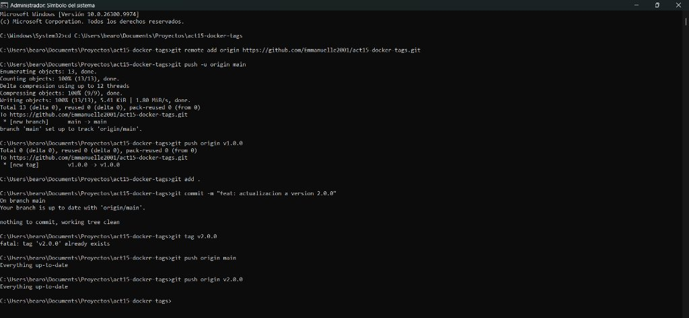
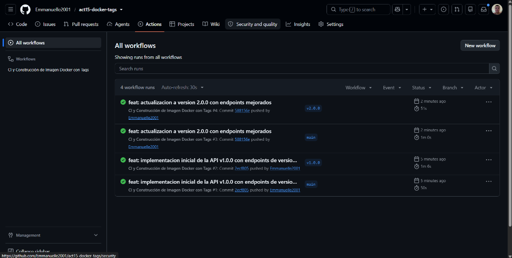
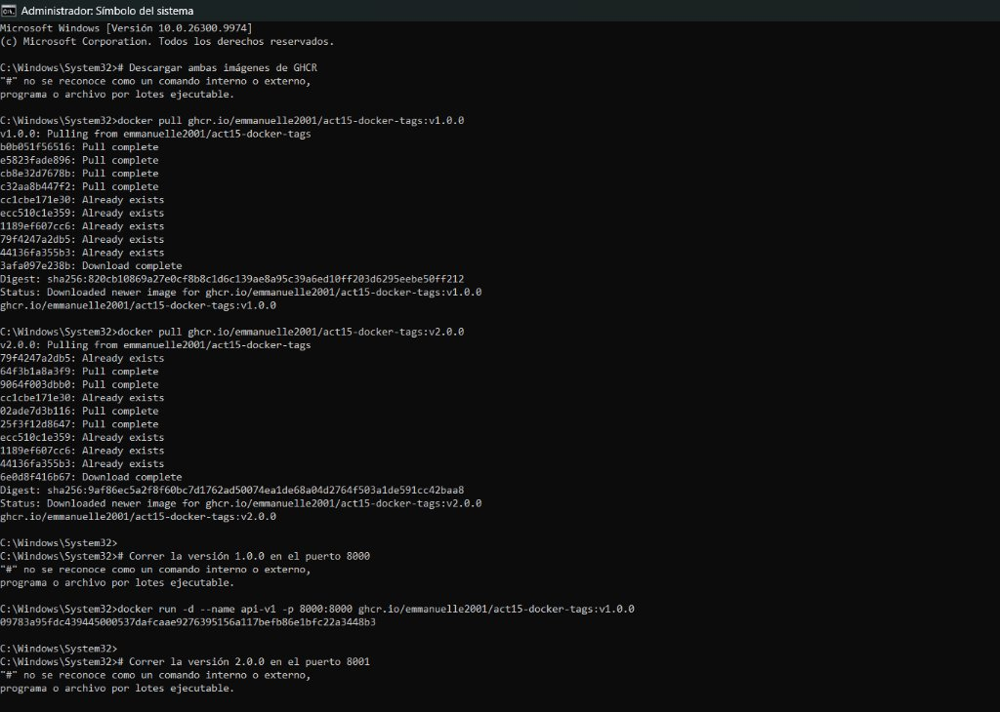
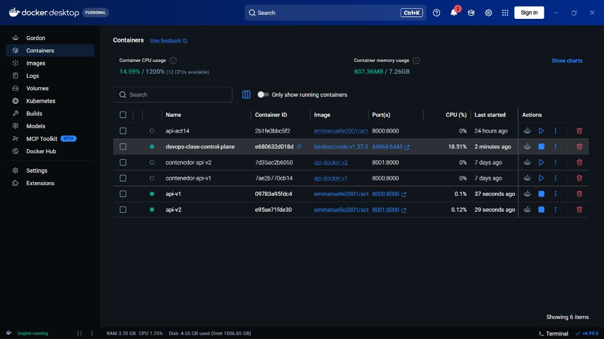
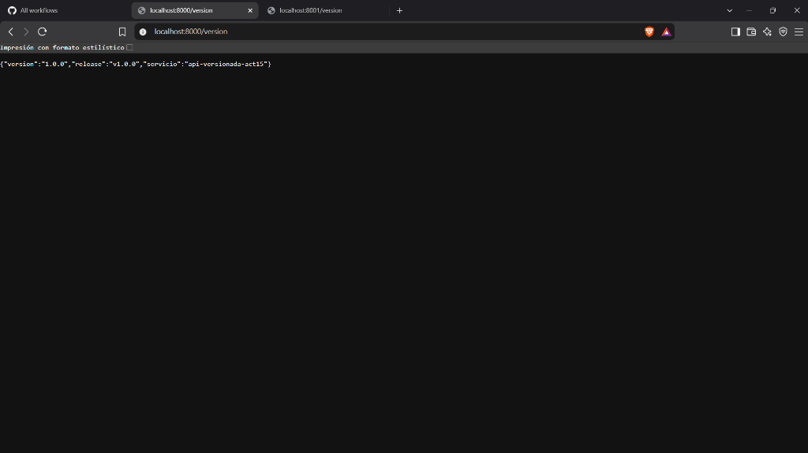
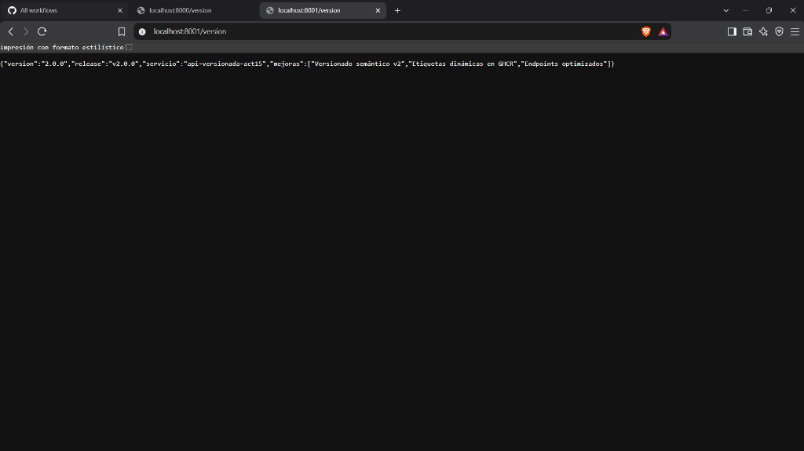

# ACTIVIDAD 15: USO DE VERSIONES Y TAGS EN GITHUB Y DOCKER

**Asignatura:** Gestión del Proceso de Desarrollo de Software  
**Alumno:** Emmanuelle Hernández Oropeza  
**Fecha de Entrega:** 17 de noviembre de 2026  

---

## 1. Introducción y Objetivos
El propósito de esta práctica es implementar el versionado semántico de una API en un ciclo de integración y entrega continua (CI/CD) combinando Git Tags, GitHub Actions y GitHub Container Registry (GHCR).

A lo largo de la actividad se incorporan endpoints para consultar la versión y el estado de la aplicación, se ajusta el pipeline automatizado para etiquetar de manera dinámica las imágenes generadas mediante el paso Preparar nombre y etiquetas, y se descargan dos versiones distintas (v1.0.0 y v2.0.0) para ejecutarlas en simultáneo en Docker sobre puertos distintos, validando su coexistencia y operatividad independiente.

---

## 2. Implementación Técnica

### 2.1. Endpoints de Versión y Estado en la API
Se implementaron dos endpoints específicos dentro de la aplicación FastAPI para permitir la inspección externa de la versión en ejecución y la comprobación de salud del servicio:
- `/version`: Retorna la versión del servicio y el identificador de release correspondiente.
- `/status`: Confirma el estado operativo del contenedor junto con el hostname interno y timestamp.

### 2.2. Ajuste del Step en GitHub Actions
En el flujo de trabajo de GitHub Actions se modificó el step de generación de etiquetas para extraer dinámicamente la etiqueta de versión desde la referencia de Git (`GITHUB_REF_NAME`), etiquetando la imagen en GHCR con la versión específica y con la etiqueta latest:

```yaml
- name: Preparar nombre y etiquetas
  id: image
  shell: bash
  run: |
    IMAGE_NAME="ghcr.io/${GITHUB_REPOSITORY,,}"
    TAG="${GITHUB_REF_NAME}"
    echo "Generando etiquetas para: ${IMAGE_NAME} con tag: ${TAG}"
    echo "tags=${IMAGE_NAME}:${TAG},${IMAGE_NAME}:latest" >> "$GITHUB_OUTPUT"
```

### 2.3. Control de Versiones con Git Tags
Para disparar la construcción de cada versión sin alterar la rama principal, se utilizaron etiquetas de Git anotadas con el formato semántico v1.0.0 y v2.0.0:

```bash
# Etiquetar y publicar la versión 1.0.0
git tag v1.0.0
git push origin v1.0.0

# Tras actualizar el código a la versión 2.0.0
git add .
git commit -m "feat: actualizacion a version 2.0.0"
git tag v2.0.0
git push origin main
git push origin v2.0.0
```

---

## 3. Evidencias de Ejecución

### 3.1. Versionado y Creación de Etiquetas con Git Tags
Se inicializó el repositorio y se publicaron las ramas y etiquetas correspondientes a las versiones v1.0.0 y v2.0.0:


*Figura 1. Creación y publicación de etiquetas de versión v1.0.0 y v2.0.0 en Git.*

---

### 3.2. Ejecución Automatizada en GitHub Actions (Tags v1.0.0 y v2.0.0)
El pipeline de GitHub Actions se activó automáticamente ante el push de cada tag y commit, compilando y publicando exitosamente ambas versiones de la imagen en GHCR:


*Figura 2. Ejecución satisfactoria de los workflows para los tags v1.0.0 y v2.0.0 en GitHub Actions.*

---

### 3.3. Descarga de Imágenes y Ejecución Simultánea con Docker
Se descargaron ambas versiones desde GitHub Container Registry con docker pull y se instanciaron dos contenedores asignando el puerto 8000 para api-v1 y el puerto 8001 para api-v2:


*Figura 3. Descarga y ejecución en segundo plano de api-v1 (puerto 8000) y api-v2 (puerto 8001).*

---

### 3.4. Verificación de Contenedores Simultáneos en Docker Desktop
En la consola de administración de Docker Desktop se corroboró que ambos contenedores se encuentran en estado activo y en ejecución simultánea:


*Figura 4. Panel de Docker Desktop mostrando los contenedores api-v1 y api-v2 corriendo al mismo tiempo.*

---

### 3.5. Comprobación en Navegador: Versión 1.0.0 (Puerto 8000)
Se realizó la consulta al endpoint /version en http://localhost:8000 confirmando la respuesta de la primera versión:


*Figura 5. Endpoint /version en puerto 8000 respondiendo con versión 1.0.0.*

---

### 3.6. Comprobación en Navegador: Versión 2.0.0 (Puerto 8001)
Se realizó la consulta al endpoint /version en http://localhost:8001 validando la respuesta de la segunda versión con las mejoras implementadas:


*Figura 6. Endpoint /version en puerto 8001 respondiendo con versión 2.0.0 y sus mejoras.*

---

## 4. Conclusión
El uso coordinado de etiquetas de Git y registros de contenedores permite mantener una trazabilidad exacta entre el historial de código fuente y los binarios distribuidos. La ejecución simultánea de contenedores con diferentes versiones en un mismo host valida la portabilidad y aislamiento que ofrece Docker, facilitando estrategias de despliegue continuo como pruebas A/B o transiciones de versión sin interrupción de servicio.
